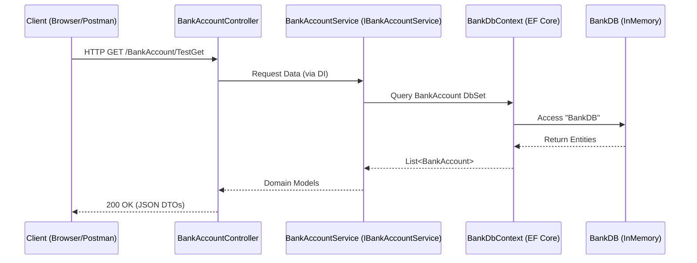

# API Layer

# API Layer

<details>
<summary>Relevant source files</summary>

The following files were used as context for generating this wiki page:

- [src/Api/Api.csproj](src/Api/Api.csproj)
- [src/Api/Program.cs](src/Api/Program.cs)
- [src/Api/Properties/launchSettings.json](src/Api/Properties/launchSettings.json)

</details>


The **API Layer** serves as the entry point and the **Composition Root** for the BankAccountApi application. It is implemented in the `src/Api` project and is responsible for bootstrapping the application, configuring the Dependency Injection (DI) container, defining the middleware pipeline, and exposing the HTTP interface via controllers.

## Composition Root & Dependencies

As the composition root, the API project holds references to all other layers in the solution to wire up their implementations. It depends on `Domain` for interfaces, `Application` for service implementations, and `Infrastructure` for data persistence [src/Api/Api.csproj:14-18]().

### Dependency Injection Registration
The application uses the built-in .NET DI container to manage object lifetimes. Key registrations include:
*   **Controllers**: Registered via `builder.Services.AddControllers()` [src/Api/Program.cs:10]().
*   **Database Context**: `BankDbContext` is registered with an In-Memory provider named `"BankDB"` [src/Api/Program.cs:15]().
*   **Business Services**: The `IBankAccountService` interface is mapped to the `BankAccountService` implementation with a `Scoped` lifetime [src/Api/Program.cs:16]().

**Sources:** [src/Api/Api.csproj:1-21](), [src/Api/Program.cs:1-17]()

## Bootstrapping Process

The application lifecycle is defined in `Program.cs`. It follows the standard .NET 6+ minimal hosting model.

### Initialization Sequence
1.  **Builder Creation**: Initializes the `WebApplicationBuilder` [src/Api/Program.cs:6]().
2.  **Service Configuration**: Registers framework and application services (Swagger, DB, DI) [src/Api/Program.cs:10-16]().
3.  **App Building**: Generates the `WebApplication` instance [src/Api/Program.cs:18]().
4.  **Database Seeding**: Creates a temporary scope to resolve the `BankDbContext` and invokes `SeedData.Seed()` to populate the in-memory store [src/Api/Program.cs:21-32]().
5.  **Middleware Configuration**: Defines how HTTP requests are handled [src/Api/Program.cs:34-42]().
6.  **Execution**: Starts the web server [src/Api/Program.cs:44]().

### Data Seeding and Validation
During startup, the API layer ensures the database is correctly initialized. It specifically verifies the existence of a seed record for "Steve" [src/Api/Program.cs:27](). If this record is missing after seeding, the application throws an exception to prevent starting in an invalid state [src/Api/Program.cs:30]().

**Sources:** [src/Api/Program.cs:6-44]()

## Middleware Pipeline

The middleware pipeline determines how HTTP requests flow through the system.

### Request Pipeline Diagram
This diagram illustrates the flow from an incoming HTTP request to the internal code entities.

| Step | Middleware / Component | File Reference |
| :--- | :--- | :--- |
| 1 | **Swagger/UI** | `app.UseSwagger()` [src/Api/Program.cs:36-37]() |
| 2 | **Authorization** | `app.UseAuthorization()` [src/Api/Program.cs:40]() |
| 3 | **Routing** | `app.MapControllers()` [src/Api/Program.cs:42]() |
| 4 | **Controller** | `BankAccountController` |

### Pipeline Logic
The pipeline includes conditional logic for development environments. Swagger and the Swagger UI are only enabled if `ASPNETCORE_ENVIRONMENT` is set to `Development` [src/Api/Program.cs:34-38]().

**Sources:** [src/Api/Program.cs:33-42](), [src/Api/Properties/launchSettings.json:18-20]()

## Infrastructure & API Integration

The following diagram bridges the "Natural Language" concepts of the API to the specific "Code Entities" that implement them.

**API Infrastructure Mapping**
```mermaid
graph TD
    subgraph "External Access"
        "HTTP_Client" -->|":5239/swagger"| "SwaggerUI"
    end

    subgraph "API Project (Composition Root)"
        "Program.cs" -->|"builder.Services"| "DI_Container"
        "DI_Container" -->|"Register"| "BankDbContext"
        "DI_Container" -->|"Register"| "IBankAccountService"
        "Program.cs" -->|"Invoke"| "SeedData"
    end

    subgraph "Infrastructure Project"
        "SeedData" -->|"Populate"| "InMemoryDatabase"
        "BankDbContext" -->|"Query"| "InMemoryDatabase"
    end

    subgraph "Application Project"
        "BankAccountService" -.->|"Implements"| "IBankAccountService"
    end
```
**Sources:** [src/Api/Program.cs:15-25](), [src/Api/Properties/launchSettings.json:17](), [src/Api/Api.csproj:14-18]()

## Execution Profiles

The API layer defines two primary ways to run the application, configured in `launchSettings.json`.

| Profile Name | Command | URL | Environment |
| :--- | :--- | :--- | :--- |
| **BankAccountApi** | `Project` (Kestrel) | `http://localhost:5239` | Development |
| **IIS Express** | `IISExpress` | `http://localhost:55502` | Development |

Both profiles are configured to automatically launch the browser to the `/swagger` endpoint upon startup [src/Api/Properties/launchSettings.json:16, 25]().

### Data Flow: Request to Persistence
The following diagram shows the technical data flow from the API layer through the application architecture.

**Technical Data Flow**

**Sources:** [src/Api/Program.cs:15-16](), [src/Api/Properties/launchSettings.json:12-31]()

---