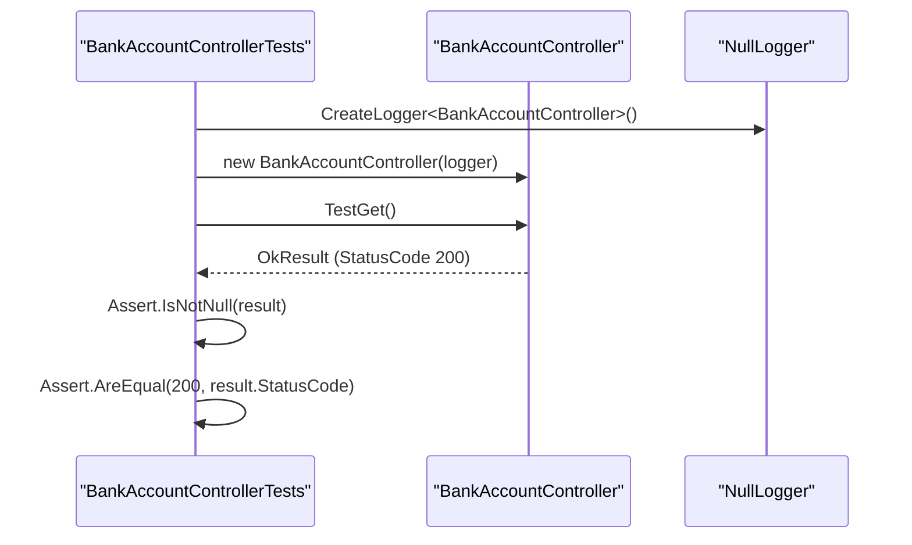

# API Unit Tests

# API Unit Tests

<details>
<summary>Relevant source files</summary>

The following files were used as context for generating this wiki page:

- [tests/ApiUnitTests/ApiUnitTests.csproj](tests/ApiUnitTests/ApiUnitTests.csproj)
- [tests/ApiUnitTests/BankAccountControllerTests.cs](tests/ApiUnitTests/BankAccountControllerTests.cs)
- [tests/ApiUnitTests/Usings.cs](tests/ApiUnitTests/Usings.cs)

</details>


The `ApiUnitTests` project provides unit testing for the API layer of the BankAccountApi. Its primary focus is verifying the behavior of controllers in isolation from the underlying business logic and infrastructure layers. Currently, it validates the routing and basic response capabilities of the `BankAccountController` using the MSTest framework and Moq for dependency management.

### Project Configuration and Dependencies

The test project is built on `.NET 6.0` [tests/ApiUnitTests/ApiUnitTests.csproj:4-4]() and utilizes `MSTest` as the primary testing engine [tests/ApiUnitTests/ApiUnitTests.csproj:14-15](). It references the `Api` project to gain access to the controllers and the `Domain` project for entity definitions [tests/ApiUnitTests/ApiUnitTests.csproj:20-21]().

| Dependency | Purpose |
| :--- | :--- |
| `Moq` | Used for creating mock implementations of interfaces like `IBankAccountService` [tests/ApiUnitTests/ApiUnitTests.csproj:13-13](). |
| `Microsoft.Extensions.Logging.Abstractions` | Provides `NullLoggerFactory` to satisfy logger dependencies without actual logging overhead [tests/ApiUnitTests/BankAccountControllerTests.cs:4-4](). |
| `MSTest.TestFramework` | The assertion and test execution framework [tests/ApiUnitTests/ApiUnitTests.csproj:15-15](). |

**Sources:** [tests/ApiUnitTests/ApiUnitTests.csproj:1-24](), [tests/ApiUnitTests/BankAccountControllerTests.cs:1-7]()

### Controller Testing Strategy

The `BankAccountControllerTests` class is designed to test the `BankAccountController` by manually instantiating it and injecting required dependencies. This approach ensures that the tests are verifying the controller logic rather than the integration of the entire web host.

#### Use of NullLoggerFactory
To satisfy the `ILogger<BankAccountController>` dependency required by the controller constructor, the test suite utilizes `NullLoggerFactory.Instance.CreateLogger<BankAccountController>()` [tests/ApiUnitTests/BankAccountControllerTests.cs:16-16](). This allows the controller to perform logging operations during tests without requiring a complex logging provider setup or asserting against log output.

#### Dependency Isolation Diagram
The following diagram illustrates how the test class isolates the controller from external concerns.

**Test Isolation and Dependency Flow**
```mermaid
graph TD
    subgraph "ApiUnitTests Project"
        [BankAccountControllerTests] --> |"Instantiates"| [BankAccountController]
        [BankAccountControllerTests] --> |"Provides"| [NullLogger]
        [NullLogger] -.-> |"Implements"| [ILogger_BankAccountController]
    end

    subgraph "Api Project"
        [BankAccountController] --> |"Requires"| [ILogger_BankAccountController]
    end
    
    style [BankAccountControllerTests] stroke-dasharray: 5 5
```
**Sources:** [tests/ApiUnitTests/BankAccountControllerTests.cs:12-17](), [tests/ApiUnitTests/ApiUnitTests.csproj:12-17]()

### Test Implementation: TestGet_Test

The current implementation contains a single test method, `TestGet_Test`, which follows the **Arrange-Act-Assert** pattern to verify the `TestGet` endpoint.

1.  **Arrange**: A `NullLogger` is created and the `BankAccountController` is initialized [tests/ApiUnitTests/BankAccountControllerTests.cs:16-17]().
2.  **Act**: The `TestGet()` method is invoked on the controller [tests/ApiUnitTests/BankAccountControllerTests.cs:20-20]().
3.  **Assert**: The result is cast to an `OkResult`, and the test verifies that the status code returned is `200 OK` [tests/ApiUnitTests/BankAccountControllerTests.cs:23-24]().

**Sequence of Test Execution**

**Sources:** [tests/ApiUnitTests/BankAccountControllerTests.cs:13-25]()

### Future Mocking with Moq

While the current controller implementation only requires a logger, the project includes the `Moq` library [tests/ApiUnitTests/ApiUnitTests.csproj:13-13]() to facilitate the mocking of the `IBankAccountService`. As business logic is added to the controller (e.g., for deposits or transfers), the `IBankAccountService` will be injected into the controller. The test suite will then use `Mock<IBankAccountService>` to define expected behaviors and return values, ensuring the API layer remains decoupled from the Application layer during unit testing.

**Sources:** [tests/ApiUnitTests/ApiUnitTests.csproj:13-13](), [tests/ApiUnitTests/BankAccountControllerTests.cs:1-25]()

---