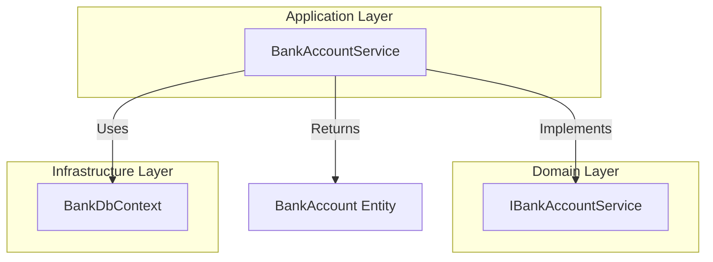
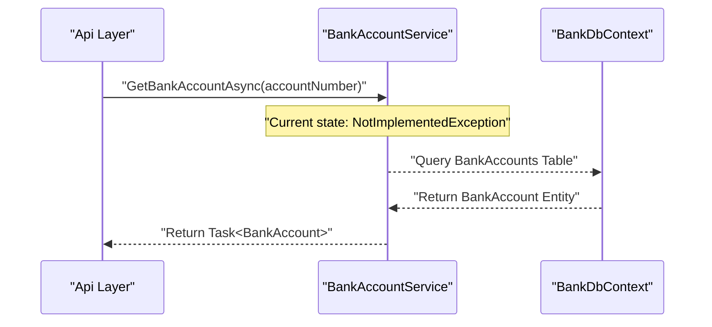

# Application Layer

# Application Layer

Relevant source files

The following files were used as context for generating this wiki page:

- [src/Application/Application.csproj](src/Application/Application.csproj)
- [src/Application/Services/BankAccountService.cs](src/Application/Services/BankAccountService.cs)

The Application layer serves as the orchestrator of business logic within the `BankAccountApi` system. It acts as the bridge between the external-facing API and the internal Domain and Infrastructure layers [src/Application/Application.csproj:9-12](). This layer contains the concrete implementation of services defined in the Domain layer, utilizing the Infrastructure layer for data persistence.

## BankAccountService Implementation

The core of this project is the `BankAccountService` class, which implements the `IBankAccountService` interface [src/Application/Services/BankAccountService.cs:7-8]().

### Dependency Injection
The service follows the Dependency Inversion Principle by requiring a `BankDbContext` through its constructor [src/Application/Services/BankAccountService.cs:11-14](). This allows the service to interact with the database context defined in the Infrastructure layer to perform CRUD operations on `BankAccount` entities.

### Current Implementation State
As of the current version, the service is in a scaffold/placeholder state. While the structure is in place to handle banking operations, the methods are not yet functional:

| Method | Purpose | Status |
| :--- | :--- | :--- |
| `GetBankAccountAsync` | Retrieves a specific account by its number | Throws `NotImplementedException` [src/Application/Services/BankAccountService.cs:16-19]() |

**Sources:**
- [src/Application/Services/BankAccountService.cs:7-20]()
- [src/Application/Application.csproj:9-12]()

## Data Flow and Dependencies

The Application layer is positioned centrally in the dependency graph. It references both the Domain layer (to access models and interfaces) and the Infrastructure layer (to access the DbContext) [src/Application/Application.csproj:9-12]().

### Code Entity Relationship Diagram
The following diagram illustrates how the `BankAccountService` bridges the interface defined in the Domain layer with the persistence mechanism in the Infrastructure layer.

**Bridge: Interface to Implementation**

**Sources:**
- [src/Application/Services/BankAccountService.cs:1-14]()
- [src/Application/Application.csproj:9-12]()

## Logic Orchestration

The Application layer is intended to host the use cases of the system. In future iterations, this layer will manage transactions, validate business rules (e.g., ensuring sufficient funds before a withdrawal), and map Domain entities to DTOs.

### System Logic Flow
The diagram below shows the intended flow of data through the `BankAccountService` when a request is processed.

**Service Data Flow**

**Sources:**
- [src/Application/Services/BankAccountService.cs:7-20]()
- [src/Application/Application.csproj:1-15]()

---