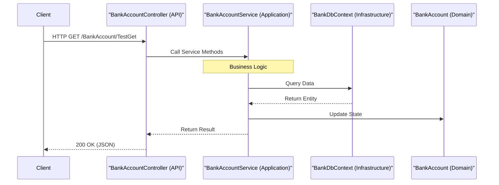

# Architecture

# Architecture

<details>
<summary>Relevant source files</summary>

The following files were used as context for generating this wiki page:

- [BankAccountApi.sln](BankAccountApi.sln)
- [src/Api/Api.csproj](src/Api/Api.csproj)
- [src/Application/Application.csproj](src/Application/Application.csproj)
- [src/Domain/Domain.csproj](src/Domain/Domain.csproj)
- [src/Infrastructure/Infrastructure.csproj](src/Infrastructure/Infrastructure.csproj)

</details>


The **BankAccountApi** is built following the **Clean Architecture** (or Onion Architecture) pattern. This architectural style promotes a separation of concerns by organizing the system into concentric layers, where dependencies only point inwards toward the core business logic.

This structure ensures that the business rules are independent of external frameworks, databases, or UI implementations, making the system more maintainable and testable.

### Architectural Dependency Flow

The following diagram illustrates the dependency flow between the projects. Notice that the `Domain` project has no dependencies, serving as the core of the system.

**Project Dependency Graph**
```mermaid
graph TD
    subgraph ["Code Entity Space"]
        ["Api.csproj"] --> ["Application.csproj"]
        ["Api.csproj"] --> ["Infrastructure.csproj"]
        ["Api.csproj"] --> ["Domain.csproj"]
        
        ["Application.csproj"] --> ["Domain.csproj"]
        ["Application.csproj"] --> ["Infrastructure.csproj"]
        
        ["Infrastructure.csproj"] --> ["Domain.csproj"]
    end

    subgraph ["Layer Names"]
        ["Api.csproj"] --- API["API Layer"]
        ["Application.csproj"] --- APP["Application Layer"]
        ["Infrastructure.csproj"] --- INF["Infrastructure Layer"]
        ["Domain.csproj"] --- DOM["Domain Layer"]
    end
```
**Sources:**
- [src/Api/Api.csproj:15-17]()
- [src/Application/Application.csproj:10-11]()
- [src/Infrastructure/Infrastructure.csproj:14-15]()
- [src/Domain/Domain.csproj:1-9]()

---

## [Domain Layer](#2.1)

The **Domain** project is the center of the architecture. It contains the enterprise-wide business logic and entities. It is strictly forbidden for this layer to reference any other project or external library (like Entity Framework).

It defines the `BankAccount` entity and the `IBankAccountService` interface, which acts as the contract for business operations that outer layers must fulfill or utilize.

For details, see [Domain Layer](#2.1).

**Sources:**
- [src/Domain/Domain.csproj:1-9]()

---

## [Application Layer](#2.2)

The **Application** project contains the implementation of the business use cases. It implements the interfaces defined in the Domain layer and orchestrates the flow of data between the Domain entities and the Infrastructure.

The `BankAccountService` resides here, acting as the primary coordinator for banking operations like deposits and transfers. It depends on the Infrastructure layer to persist and retrieve data.

For details, see [Application Layer](#2.2).

**Sources:**
- [src/Application/Application.csproj:10-11]()

---

## [Infrastructure Layer](#2.3)

The **Infrastructure** project handles all "external" concerns. This includes data persistence via Entity Framework Core and the `BankDbContext`. In this solution, it is configured to use an in-memory database provider.

This layer is responsible for the physical implementation of data access and any integration with third-party services. It also includes the `SeedData` utility used to initialize the system state.

For details, see [Infrastructure Layer](#2.3).

**Sources:**
- [src/Infrastructure/Infrastructure.csproj:10-15]()

---

## [API Layer](#2.4)

The **Api** project is the entry point of the application and the **Composition Root**. It is responsible for:
- Configuring the Dependency Injection (DI) container.
- Setting up the Middleware pipeline.
- Exposing the HTTP surface via Controllers (e.g., `BankAccountController`).
- Integrating Swagger/OpenAPI documentation.

The API layer references all other projects to wire up the implementations (like `BankAccountService` and `BankDbContext`) to their respective interfaces.

For details, see [API Layer](#2.4).

**Sources:**
- [src/Api/Api.csproj:10-17]()

---

### Component Interaction

The following diagram demonstrates how a request flows through the code entities across the layers, adhering to the Dependency Inversion Principle.

**Request Flow: Natural Language to Code Entities**

**Sources:**
- [src/Api/Api.csproj:15-17]()
- [src/Application/Application.csproj:10-11]()
- [src/Infrastructure/Infrastructure.csproj:10-11]()

---