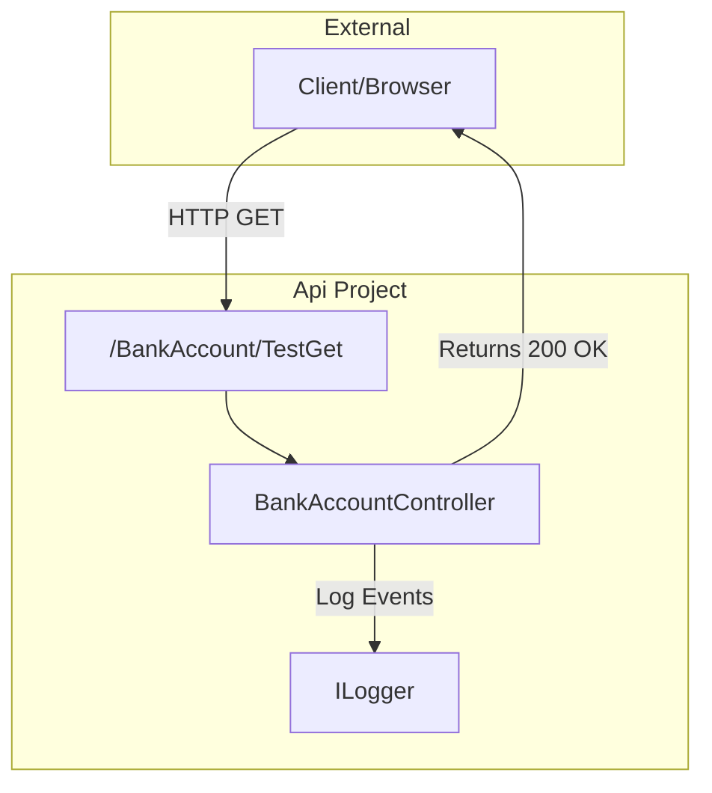

# BankAccountController

# BankAccountController

<details>
<summary>Relevant source files</summary>

The following files were used as context for generating this wiki page:

- [src/Api/Controllers/BankAccountApiController.cs](src/Api/Controllers/BankAccountApiController.cs)

</details>


The `BankAccountController` serves as the primary entry point for HTTP requests related to banking operations. It is located within the `Api` project and is responsible for handling incoming web requests, interacting with the application layer, and returning appropriate HTTP responses.

## Controller Definition

The controller is defined with the `[ApiController]` attribute to enable API-specific behaviors like automatic model state validation and requirement of attribute routing [src/Api/Controllers/BankAccountApiController.cs:10-10]().

### Base Route and Naming
The controller uses the standard ASP.NET Core token replacement for its route.
*   **Route:** `[Route("[controller]")]` maps to `/BankAccount` [src/Api/Controllers/BankAccountApiController.cs:11-11]().
*   **Class Name:** `BankAccountController` [src/Api/Controllers/BankAccountApiController.cs:12-12]().

### Dependency Injection
The controller currently utilizes constructor injection to receive an `ILogger` instance, which is used for telemetry and diagnostic logging within the controller's actions [src/Api/Controllers/BankAccountApiController.cs:14-19]().

## Endpoint Implementation

Currently, the controller contains a placeholder endpoint used for verifying the API's reachability.

### TestGet Endpoint
*   **Method:** `GET` [src/Api/Controllers/BankAccountApiController.cs:21-21]()
*   **Sub-route:** `TestGet` [src/Api/Controllers/BankAccountApiController.cs:22-22]()
*   **Full Path:** `/BankAccount/TestGet`
*   **Behavior:** Returns an `HTTP 200 OK` response without a body [src/Api/Controllers/BankAccountApiController.cs:23-27]().

### Request Flow Diagram
This diagram illustrates the flow of a request from the network through the API layer entities.

**Request Processing Path**

Sources: [src/Api/Controllers/BankAccountApiController.cs:11-27]()

## Planned Functionality (TODOs)

The `BankAccountController` is designed to eventually serve as the interface for the core banking operations defined in the project requirements. While the implementation logic will reside in the `Application` layer, the controller will expose the following functional stubs:

| Operation | HTTP Method | Responsibility |
| :--- | :--- | :--- |
| **Deposit** | `POST` | Accept funds into a specific account. |
| **Withdrawal** | `POST` | Deduct funds from an account balance. |
| **Transfer** | `POST` | Move funds between two internal accounts. |
| **Balance** | `GET` | Retrieve the current available balance for an account. |
| **History** | `GET` | List previous transactions for an account. |

### Code-to-Logic Mapping
The following diagram bridges the current code structure to the intended functional domain.

**Controller Domain Mapping**
```mermaid
classDiagram
    class BankAccountController {
        -ILogger _logger
        +TestGet() IActionResult
        +Deposit() TODO
        +Withdrawal() TODO
        +Transfer() TODO
        +GetBalance() TODO
        +GetHistory() TODO
    }

    class "HTTP Route: /BankAccount" as Route {
        <<Interface>>
    }

    BankAccountController --|> Route : "Exposes"
```
Sources: [src/Api/Controllers/BankAccountApiController.cs:11-28]()

---