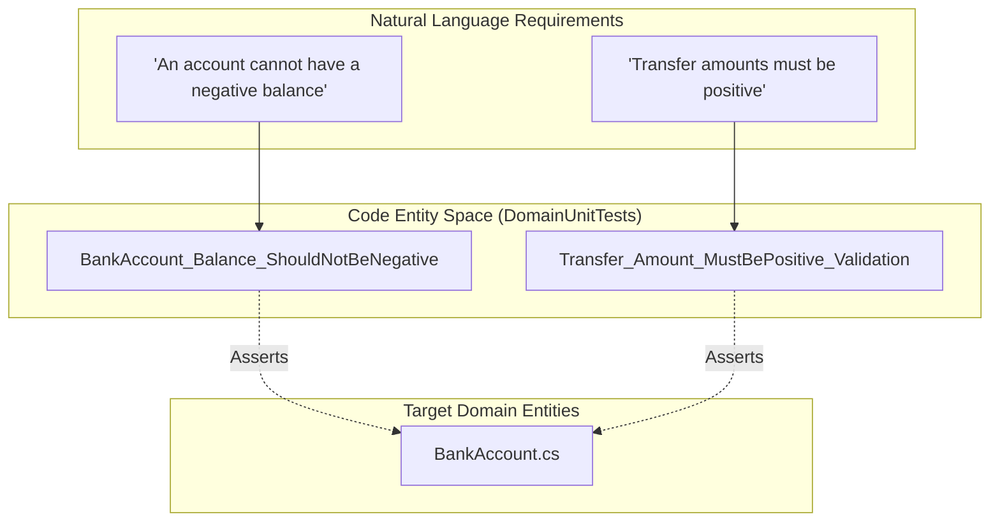
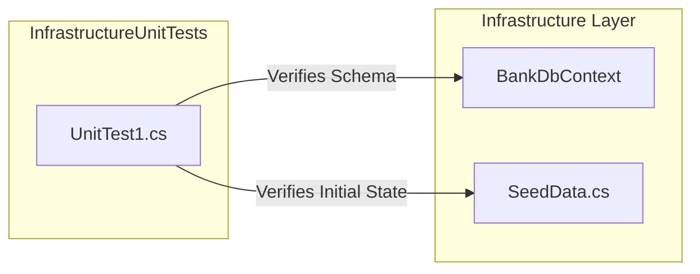

# Domain & Infrastructure Unit Tests

# Domain & Infrastructure Unit Tests

Relevant source files

The following files were used as context for generating this wiki page:

- [tests/DomainUnitTests/DomainUnitTests.csproj](tests/DomainUnitTests/DomainUnitTests.csproj)
- [tests/DomainUnitTests/UnitTest1.cs](tests/DomainUnitTests/UnitTest1.cs)
- [tests/DomainUnitTests/Usings.cs](tests/DomainUnitTests/Usings.cs)
- [tests/InfrastructureUnitTests/InfrastructureUnitTests.csproj](tests/InfrastructureUnitTests/InfrastructureUnitTests.csproj)
- [tests/InfrastructureUnitTests/UnitTest1.cs](tests/InfrastructureUnitTests/UnitTest1.cs)
- [tests/InfrastructureUnitTests/Usings.cs](tests/InfrastructureUnitTests/Usings.cs)

The `DomainUnitTests` and `InfrastructureUnitTests` projects provide the testing infrastructure for the core business logic and data persistence layers of the BankAccountApi. Currently, these projects exist as scaffolded shells intended to house future test suites for the domain models and database context configurations.

## Project Configuration and Stack

Both projects are built on `.NET 6.0` and utilize the **MSTest** framework for test execution and assertion. They share a common set of dependencies for test discovery and code coverage reporting.

### Dependency Stack
| Package | Version | Purpose |
| :--- | :--- | :--- |
| `Microsoft.NET.Test.Sdk` | 17.3.2 | Core MS test host logic. |
| `MSTest.TestFramework` | 2.2.10 | Attributes like `[TestClass]` and `[TestMethod]`. |
| `MSTest.TestAdapter` | 2.2.10 | Enables Visual Studio and CLI test discovery. |
| `coverlet.collector` | 3.1.2 | Cross-platform code coverage support. |

**Sources:**
- [tests/DomainUnitTests/DomainUnitTests.csproj:1-18]()
- [tests/InfrastructureUnitTests/InfrastructureUnitTests.csproj:1-18]()

---

## Domain Unit Tests

The `DomainUnitTests` project is designed to validate the `Domain` layer. In a Clean Architecture setup, this project focuses on verifying the state transitions and invariants of domain entities without any external dependencies or mocks.

### Current State
The project currently contains a placeholder class `UnitTest1` with an empty `TestMethod1`. 

### Future Test Scope: Natural Language to Code Mapping
The following diagram illustrates how future business requirements described in natural language will map to specific code entities within the testing suite.

**Domain Logic Testing Map**

**Sources:**
- [tests/DomainUnitTests/UnitTest1.cs:1-10]()
- [tests/DomainUnitTests/Usings.cs:1-1]()

---

## Infrastructure Unit Tests

The `InfrastructureUnitTests` project is responsible for verifying the `Infrastructure` layer, specifically the interaction with the Entity Framework Core `BankDbContext`.

### Current State
Similar to the domain tests, this project contains a boilerplate `UnitTest1` class.

### Future Test Scope: Data Flow and Persistence
The intended use for this project is to verify that the `BankDbContext` correctly maps domain entities to the database schema and that seed data is applied as expected.

**Infrastructure Verification Flow**

**Sources:**
- [tests/InfrastructureUnitTests/UnitTest1.cs:1-10]()
- [tests/InfrastructureUnitTests/Usings.cs:1-1]()

---

## Test Implementation Details

Both projects utilize `global using` directives to simplify test class files, ensuring that the `Microsoft.VisualStudio.TestTools.UnitTesting` namespace is available across all files in the project without explicit imports.

### Scaffolded Structure
The current implementation of the test classes follows this pattern:

| Component | Code Reference | Description |
| :--- | :--- | :--- |
| **Namespace** | `DomainUnitTests` / `InfrastructureUnitTests` | Segregates tests by architectural layer. |
| **Class Attribute** | `[TestClass]` | Marks the class as a container for test methods. |
| **Method Attribute** | `[TestMethod]` | Identifies individual test cases for the runner. |

**Sources:**
- [tests/DomainUnitTests/UnitTest1.cs:3-7]()
- [tests/InfrastructureUnitTests/UnitTest1.cs:3-7]()
- [tests/DomainUnitTests/Usings.cs:1-1]()
- [tests/InfrastructureUnitTests/Usings.cs:1-1]()

---