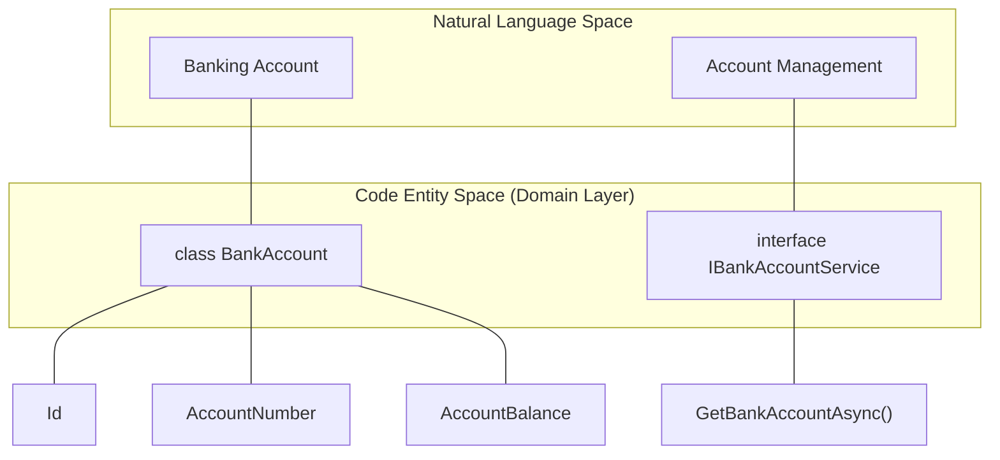
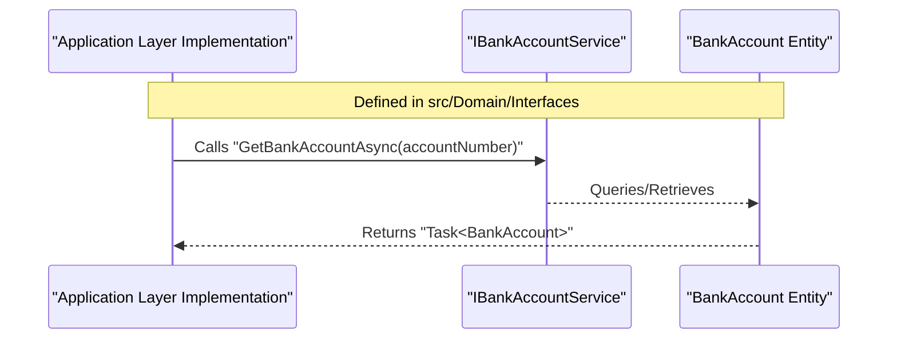

# Domain Layer

# Domain Layer

Relevant source files

The following files were used as context for generating this wiki page:

- [src/Domain/Domain.csproj](src/Domain/Domain.csproj)
- [src/Domain/Interfaces/IBankAccountService.cs](src/Domain/Interfaces/IBankAccountService.cs)
- [src/Domain/Models/BankAccount.cs](src/Domain/Models/BankAccount.cs)

The Domain layer is the core of the `BankAccountApi` application. It contains the enterprise business rules, entities, and interface contracts that define the system's capabilities. Following Clean Architecture principles, this layer is isolated and has no dependencies on any other project in the solution, including the Application or Infrastructure layers [src/Domain/Domain.csproj:1-9]().

## Core Principles

The Domain project is a lightweight Class Library targeting `.NET 6.0` [src/Domain/Domain.csproj:4-4](). Its primary responsibilities include:
*   **Entity Definition**: Modeling the fundamental data structures of the banking system.
*   **Contract Definition**: Defining interfaces that other layers must implement to provide business functionality.
*   **Zero Dependency**: The project file contains no `<ProjectReference>` or external NuGet packages, ensuring business logic remains pure and decoupled from framework concerns [src/Domain/Domain.csproj:1-9]().

## Domain Models

The primary entity in this layer is the `BankAccount` class. This model represents the persistent state of a customer's account within the system.

### BankAccount Entity
The `BankAccount` class defines the schema for account data, including identifiers, ownership information, and financial balances [src/Domain/Models/BankAccount.cs:5-14]().

| Property | Type | Description |
| :--- | :--- | :--- |
| `Id` | `int` | The primary unique identifier for the account [src/Domain/Models/BankAccount.cs:7-7](). |
| `AccountNumber` | `string` | The unique public-facing account string [src/Domain/Models/BankAccount.cs:8-8](). |
| `AccountHolder` | `string` | The name of the person or entity owning the account [src/Domain/Models/BankAccount.cs:9-9](). |
| `AccountBalance` | `decimal` | The current monetary balance, stored with `decimal(16,4)` precision [src/Domain/Models/BankAccount.cs:10-11](). |
| `DepositHistory` | `string` | A record of all deposit transactions associated with the account [src/Domain/Models/BankAccount.cs:12-12](). |
| `WithdrawalHistory` | `string` | A record of all withdrawal transactions associated with the account [src/Domain/Models/BankAccount.cs:13-13](). |

**Sources:**
* [src/Domain/Models/BankAccount.cs:1-14]()

## Service Interfaces

The Domain layer defines the behavior of the system through interfaces. These interfaces act as a contract that the Application layer must satisfy.

### IBankAccountService
The `IBankAccountService` interface defines the primary entry point for account-related business operations [src/Domain/Interfaces/IBankAccountService.cs:5-8]().

*   **`GetBankAccountAsync(string accountNumber)`**: An asynchronous method that retrieves a `BankAccount` entity based on its unique account number [src/Domain/Interfaces/IBankAccountService.cs:7-7]().

**Sources:**
* [src/Domain/Interfaces/IBankAccountService.cs:1-8]()

## Architectural Mapping

The following diagrams illustrate how the Domain layer concepts map to the code entities and how data flows through the interface contracts.

### Concept to Code Mapping
This diagram bridges the natural language banking concepts to the specific C# classes and interfaces defined in the Domain project.

**Sources:**
* [src/Domain/Models/BankAccount.cs:5-14]()
* [src/Domain/Interfaces/IBankAccountService.cs:5-8]()

### Domain Data Flow Contract
This diagram shows the expected flow of data as defined by the `IBankAccountService` contract.

**Sources:**
* [src/Domain/Interfaces/IBankAccountService.cs:5-8]()
* [src/Domain/Models/BankAccount.cs:5-14]()

---