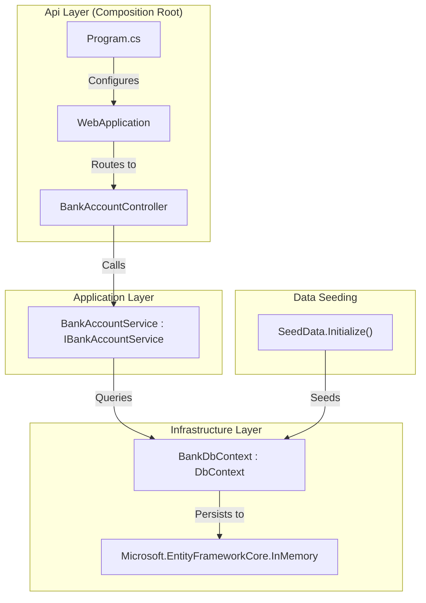
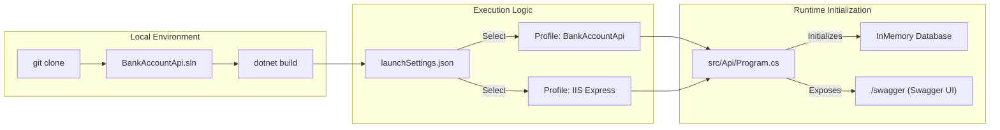

# Getting Started

# Getting Started

Relevant source files

The following files were used as context for generating this wiki page:

- [BankAccountApi.sln](BankAccountApi.sln)
- [src/Api/Api.csproj](src/Api/Api.csproj)
- [src/Api/Properties/launchSettings.json](src/Api/Properties/launchSettings.json)

This page provides the technical instructions required to clone, build, and run the **BankAccountApi** project locally. It details the solution architecture, available execution profiles, and the automated initialization of the in-memory data store.

## Prerequisites

The project is built on **.NET 6.0** [src/Api/Api.csproj:4-4](). Ensure you have the .NET 6 SDK installed on your workstation before proceeding.

## Solution Structure

The project follows a Clean Architecture pattern, organized into a Visual Studio Solution (`BankAccountApi.sln`) containing two primary logical folders: `src` for application logic and `tests` for the test suites [BankAccountApi.sln:11-20]().

| Project | Path | Responsibility |
| :--- | :--- | :--- |
| **Api** | `src/Api` | The entry point, composition root, and HTTP interface. |
| **Application** | `src/Application` | Business logic implementation and service orchestration. |
| **Domain** | `src/Domain` | Core entities and service interfaces. |
| **Infrastructure** | `src/Infrastructure` | Data access (EF Core) and external concerns. |

**Sources:** [BankAccountApi.sln:13-28]()

## Execution and Launch Profiles

The API project includes two primary launch profiles defined in the `launchSettings.json` file. Both profiles are configured to launch the browser automatically to the `/swagger` endpoint when the application starts in the `Development` environment [src/Api/Properties/launchSettings.json:15-20]().

### 1. Kestrel (Project Profile)
- **Profile Name:** `BankAccountApi`
- **Command:** `dotnet run --project src/Api`
- **URL:** `http://localhost:5239`
- **Description:** Runs the application using the cross-platform Kestrel web server. This is the recommended profile for cross-platform development.

### 2. IIS Express
- **Profile Name:** `IIS Express`
- **URL:** `http://localhost:55502`
- **Description:** Runs the application using IIS Express, typically used within Visual Studio on Windows.

**Sources:** [src/Api/Properties/launchSettings.json:11-30]()

## Data Initialization (In-Memory)

The project is configured to use an in-memory database for rapid development and testing, removing the need for a local SQL Server instance.

- **Technology:** `Microsoft.EntityFrameworkCore.InMemory` [src/Api/Api.csproj:10-10]().
- **Seeding:** The application includes a `SeedData` utility (located in the Infrastructure project) that populates the `BankDbContext` with initial records during the startup sequence.

### System Flow: Request to In-Memory Store

The following diagram illustrates how a request flows through the code entities from the entry point to the in-memory data provider.

**Request Path and Code Entity Mapping**

**Sources:** [src/Api/Api.csproj:10-17](), [BankAccountApi.sln:13-28]()

## Accessing the API

Once the application is running, the Swagger UI is available to interact with the API endpoints.

- **Swagger UI URL:** `http://localhost:5239/swagger` (Kestrel) or `http://localhost:55502/swagger` (IIS Express).
- **Default Endpoint:** The `BankAccountController` provides a `TestGet` endpoint at the route `/BankAccount` [src/Api/Properties/launchSettings.json:16-16]().

### Local Development Setup Diagram

This diagram maps the logical setup steps to the physical code structures within the repository.

**Codebase Onboarding Map**

**Sources:** [src/Api/Properties/launchSettings.json:1-31](), [BankAccountApi.sln:1-28]()

---