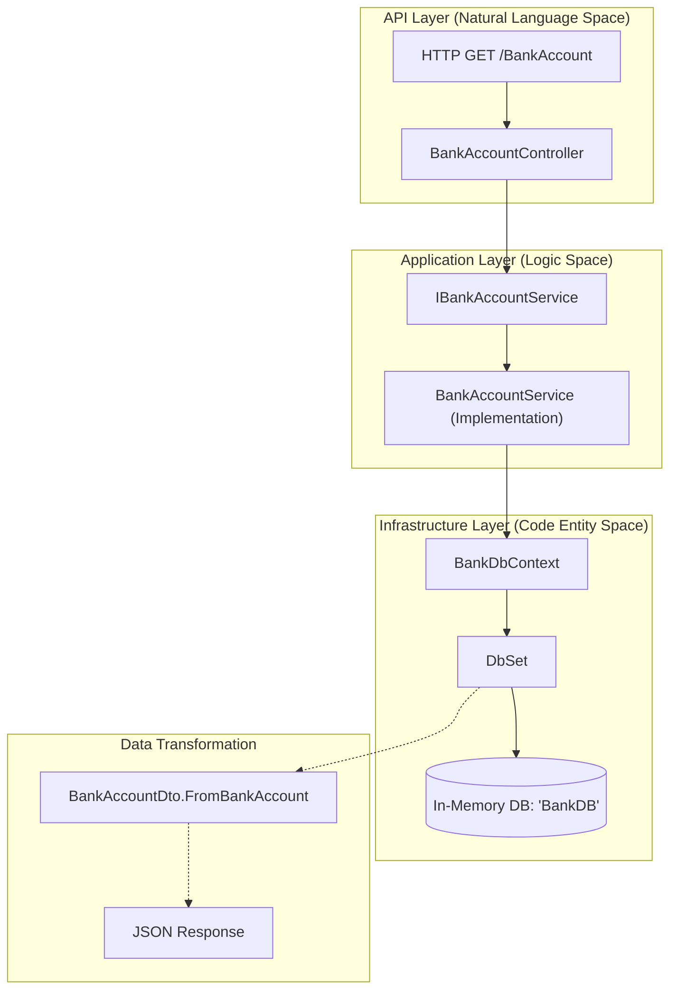
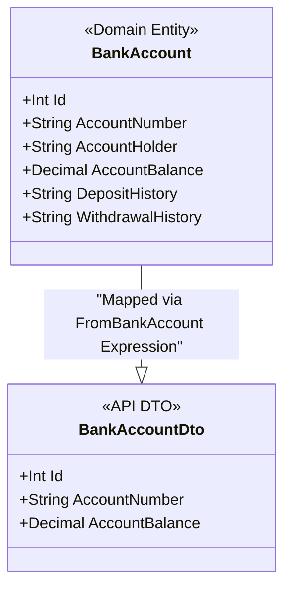

# Glossary

# Glossary

Relevant source files

The following files were used as context for generating this wiki page:

- [BankAccountApi.sln](BankAccountApi.sln)
- [README.md](README.md)
- [src/Api/Dtos/BankAccountDto.cs](src/Api/Dtos/BankAccountDto.cs)
- [src/Api/Program.cs](src/Api/Program.cs)
- [src/Domain/Models/BankAccount.cs](src/Domain/Models/BankAccount.cs)
- [src/Infrastructure/BankDbContext.cs](src/Infrastructure/BankDbContext.cs)
- [src/Infrastructure/SeedData.cs](src/Infrastructure/SeedData.cs)

This page provides a comprehensive reference for terms, domain vocabulary, and architectural concepts used within the `BankAccountApi` codebase. It serves as a bridge between the business requirements (banking operations) and the technical implementation (Clean Architecture and .NET 6).

## Domain Vocabulary (Spanish to English)

The project requirements were provided in Spanish, while the implementation uses English. The following table maps the domain terms to their code representations.

| Spanish Term | English Equivalent | Code Entity / Reference |
| :--- | :--- | :--- |
| **Cuenta Bancaria** | Bank Account | `BankAccount` [src/Domain/Models/BankAccount.cs:5-14]() |
| **Saldo** | Balance | `AccountBalance` [src/Domain/Models/BankAccount.cs:11-11]() |
| **Depósito** | Deposit | `DepositHistory` [src/Domain/Models/BankAccount.cs:12-12]() |
| **Retiro** | Withdrawal | `WithdrawalHistory` [src/Domain/Models/BankAccount.cs:13-13]() |
| **Transferencia** | Transfer | Planned feature in `README.md` [README.md:10-10]() |
| **Interés** | Interest | Planned feature for daily calculation [README.md:14-14]() |

**Sources:** [README.md:1-35](), [src/Domain/Models/BankAccount.cs:1-14]()

---

## Architectural & Framework Terms

### Clean Architecture Layers
The solution is organized into four distinct projects to enforce separation of concerns.

*   **Domain**: The innermost layer containing business entities and interface definitions. It has no dependencies on other projects [src/Domain/Domain.csproj]().
*   **Application**: Contains business logic implementations. It depends on the Domain layer [src/Application/Application.csproj]().
*   **Infrastructure**: Handles data persistence via Entity Framework Core [src/Infrastructure/Infrastructure.csproj]().
*   **Api**: The entry point (Composition Root) that handles HTTP requests and Dependency Injection [src/Api/Api.csproj]().

### Dependency Injection (DI)
The system uses the built-in .NET DI container to manage object lifetimes.
*   **Scoped**: Objects are created once per client request. Example: `IBankAccountService` is registered as scoped [src/Api/Program.cs:16-16]().
*   **DbContext**: The `BankDbContext` is registered to use an in-memory provider named `"BankDB"` [src/Api/Program.cs:15-15]().

### DTO (Data Transfer Object)
A schema used to return data through the API without exposing the internal `BankAccount` entity directly.
*   **`BankAccountDto`**: Contains a subset of fields (`Id`, `AccountNumber`, `AccountBalance`) [src/Api/Dtos/BankAccountDto.cs:6-11]().
*   **Projection**: The code uses `FromBankAccount`, a static `Expression<Func<BankAccount, BankAccountDto>>`, to map entities to DTOs at the database query level [src/Api/Dtos/BankAccountDto.cs:12-18]().

**Sources:** [src/Api/Program.cs:1-45](), [src/Api/Dtos/BankAccountDto.cs:1-19](), [BankAccountApi.sln:11-28]()

---

## Technical Terms & Components

### Entity Framework Core (EF Core)
*   **`BankDbContext`**: The primary class that coordinates EF Core functionality for the `BankAccount` model [src/Infrastructure/BankDbContext.cs:6-12]().
*   **`DbSet<BankAccount>`**: Represents the collection of bank accounts in the database [src/Infrastructure/BankDbContext.cs:11-11]().
*   **`InMemoryDatabase`**: A non-persistent database provider used for development and testing [src/Api/Program.cs:15-15]().

### Data Seeding
*   **`SeedData.Seed`**: A utility method called during application startup [src/Api/Program.cs:25-25]() to populate the in-memory database with initial records for "Steve" and "Jim Halpert" [src/Infrastructure/SeedData.cs:11-12]().

### Testing Frameworks
*   **MSTest**: The unit testing framework used for all test projects [BankAccountApi.sln:21-26]().
*   **Moq**: Utilized in `ApiUnitTests` to create mock implementations of services for isolated controller testing.

**Sources:** [src/Infrastructure/BankDbContext.cs:1-12](), [src/Infrastructure/SeedData.cs:1-18](), [src/Api/Program.cs:21-32]()

---

## Code Entity Mapping Diagrams

### Data Flow: API to Database
This diagram bridges the natural language "Get Account" request to the specific code entities that handle the data transformation and retrieval.

**Sources:** [src/Api/Program.cs:15-16](), [src/Infrastructure/BankDbContext.cs:11-11](), [src/Api/Dtos/BankAccountDto.cs:12-18]()

### Entity Model vs. DTO Mapping
This diagram shows how the internal `Domain` model maps to the external `Api` DTO, highlighting the fields exposed to the user.

**Sources:** [src/Domain/Models/BankAccount.cs:5-14](), [src/Api/Dtos/BankAccountDto.cs:6-18]()