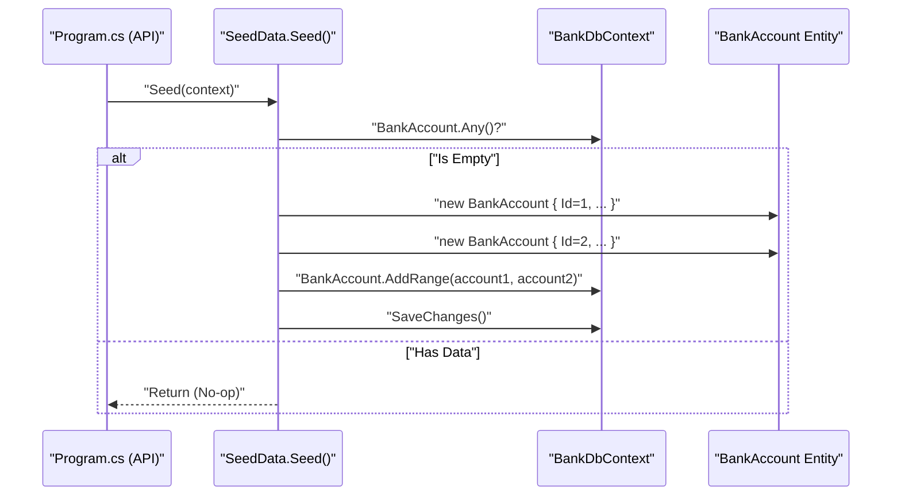

# Infrastructure Layer

# Infrastructure Layer

<details>
<summary>Relevant source files</summary>

The following files were used as context for generating this wiki page:

- [src/Infrastructure/BankDbContext.cs](src/Infrastructure/BankDbContext.cs)
- [src/Infrastructure/Infrastructure.csproj](src/Infrastructure/Infrastructure.csproj)
- [src/Infrastructure/SeedData.cs](src/Infrastructure/SeedData.cs)

</details>


The Infrastructure layer provides the concrete implementation for data access and persistence mechanisms. In this solution, it encapsulates the Entity Framework Core (EF Core) configuration and the initialization logic for the application's data store.

## Purpose and Scope

The `Infrastructure` project is responsible for:
*   **Data Persistence**: Managing the lifecycle of the database context and entity mappings [src/Infrastructure/BankDbContext.cs:6-12]().
*   **In-Memory Configuration**: Utilizing an in-memory database provider for rapid development and testing [src/Infrastructure/Infrastructure.csproj:10-10]().
*   **Data Seeding**: Providing a utility to populate the database with initial records upon application startup [src/Infrastructure/SeedData.cs:5-18]().

This layer depends directly on the **Domain Layer** to access entity models like `BankAccount` [src/Infrastructure/Infrastructure.csproj:14-14]().

---

## BankDbContext

The `BankDbContext` class is the primary gateway for interacting with the database. It inherits from `Microsoft.EntityFrameworkCore.DbContext` and exposes the domain entities as queryable sets.

### Implementation Details
The context defines a single `DbSet<BankAccount>` which corresponds to the bank account records managed by the system [src/Infrastructure/BankDbContext.cs:11-11](). It uses a standard constructor that accepts `DbContextOptions<BankDbContext>`, allowing the database provider (In-Memory) to be configured externally, typically in the API's `Program.cs` [src/Infrastructure/BankDbContext.cs:8-10]().

### Data Flow: Persistence Mapping
The following diagram illustrates how the Infrastructure layer bridges the Domain entities to the EF Core In-Memory provider.

**Entity Persistence Mapping**
```mermaid
graph TD
    subgraph "Domain Layer"
        ["BankAccount Entity"]
    end

    subgraph "Infrastructure Layer"
        ["BankDbContext"] -- "manages" --> ["DbSet<BankAccount>"]
        ["BankDbContext"] -- "uses" --> ["Microsoft.EntityFrameworkCore.InMemory"]
    end

    ["DbSet<BankAccount>"] -- "maps to" --> ["BankAccount Entity"]
```
**Sources:** [src/Infrastructure/BankDbContext.cs:1-12](), [src/Infrastructure/Infrastructure.csproj:10-14]()

---

## In-Memory Database Configuration

The project is currently configured to use `Microsoft.EntityFrameworkCore.InMemory` (version 7.0.4) [src/Infrastructure/Infrastructure.csproj:10-10](). This choice facilitates a "zero-setup" environment where no external SQL Server or database engine is required to run the API.

| Component | Technology | File Reference |
| :--- | :--- | :--- |
| **ORM** | Entity Framework Core | [src/Infrastructure/Infrastructure.csproj:10-10]() |
| **Database Provider** | In-Memory | [src/Infrastructure/Infrastructure.csproj:10-10]() |
| **Target Framework** | .NET 6.0 | [src/Infrastructure/Infrastructure.csproj:4-4]() |

**Sources:** [src/Infrastructure/Infrastructure.csproj:1-18]()

---

## SeedData Utility

The `SeedData` class provides a static method to ensure the database contains initial records for testing and demonstration purposes.

### The Seed Method
The `Seed(BankDbContext context)` function performs a check to see if the `BankAccount` table is empty using `!context.BankAccount.Any()` [src/Infrastructure/SeedData.cs:9-9](). If empty, it instantiates two default `BankAccount` objects and persists them [src/Infrastructure/SeedData.cs:11-15]().

### Initial Data State
The following records are inserted during the seeding process:

| Id | AccountNumber | AccountHolder | AccountBalance |
| :--- | :--- | :--- | :--- |
| 1 | "1234" | "Steve" | 12345.12 |
| 2 | "1235" | "Jim Halpert" | 123.10 |

Note: The `DepositHistory` and `WithdrawalHistory` fields are currently initialized with placeholder strings ("Invalid Deposit History") [src/Infrastructure/SeedData.cs:11-12]().

### Code Entity Space Bridge
This diagram shows the relationship between the `SeedData` utility and the underlying data structures.

**Data Seeding Logic**

**Sources:** [src/Infrastructure/SeedData.cs:5-18](), [src/Infrastructure/BankDbContext.cs:11-11]()

---