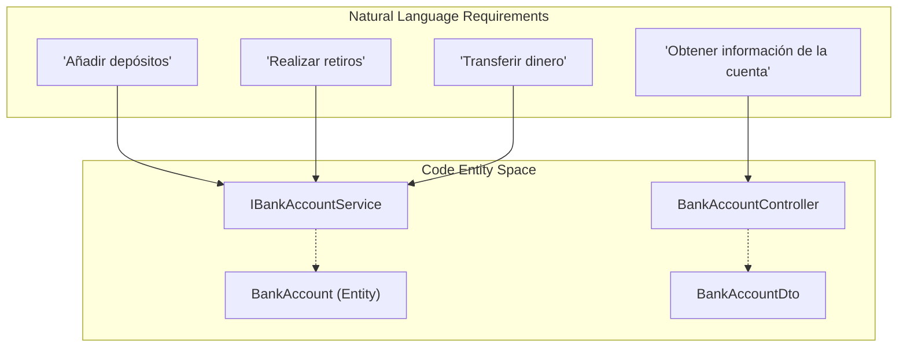
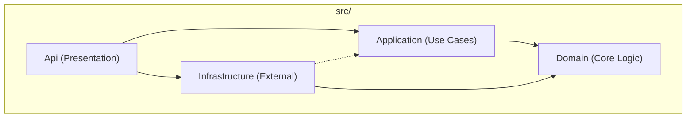

# Overview

# Overview

Relevant source files

The following files were used as context for generating this wiki page:

- [BankAccountApi.sln](BankAccountApi.sln)
- [README.md](README.md)

The `BankAccountApi` is a RESTful service built with .NET designed to manage bank account operations. Its primary purpose is to provide a robust framework for handling account information, deposits, withdrawals, transfers, and automated interest calculations [README.md:1-14]().

The project is structured following **Clean Architecture** principles to ensure separation of concerns, testability, and maintainability [README.md:25-26](). It currently serves as a foundational scaffold for a banking system, featuring an in-memory database for rapid development and testing [src/Infrastructure/DependencyInjection.cs:13-16]().

### System Concept to Code Map

The following diagram illustrates how high-level banking requirements map to specific namespaces and projects within the solution.

**Requirement Mapping Diagram**

**Sources:** [README.md:5-10](), [src/Api/Controllers/BankAccountController.cs:12-14](), [src/Domain/Entities/BankAccount.cs:3-10](), [src/Domain/Interfaces/IBankAccountService.cs:5-12]()

---

### Technology Stack

The application leverages a modern .NET stack:
*   **Framework:** .NET 7.0 (Web API)
*   **Data Access:** Entity Framework Core with an In-Memory provider [src/Infrastructure/DependencyInjection.cs:13-16]().
*   **Documentation:** Swagger/OpenAPI for endpoint exploration [src/Api/Program.cs:13-24]().
*   **Testing:** MSTest, Moq, and FluentAssertions [tests/ApiUnitTests/BankAccountControllerTests.cs:1-10]().

---

### Clean Architecture Structure

The solution is divided into four primary layers within the `src/` directory and three corresponding test projects in the `tests/` directory [BankAccountApi.sln:11-28]().

**Project Dependency Diagram**

**Sources:** [BankAccountApi.sln:11-28](), [src/Api/Api.csproj:15-18](), [src/Application/Application.csproj:10-12](), [src/Infrastructure/Infrastructure.csproj:13-15]()

#### Layer Summaries
*   **Domain:** Contains the enterprise logic, including the `BankAccount` entity and the `IBankAccountService` interface contract.
*   **Application:** Implements business rules in `BankAccountService`.
*   **Infrastructure:** Handles data persistence via `BankDbContext` and seeds initial data.
*   **Api:** The entry point (Composition Root) containing `BankAccountController` and configuration.

For a detailed breakdown of the solution layout and dependency flow, see [Project Structure](#1.2).

---

### Getting Started

To run the project locally, you must clone the repository and use the .NET CLI or Visual Studio. The API includes a `SeedData` utility that automatically populates the `BankDbContext` with sample accounts upon startup [src/Infrastructure/Persistence/SeedData.cs:7-20]().

For detailed setup instructions, including launch profiles and Swagger access, see [Getting Started](#1.1).

**Sources:** [README.md:17-21](), [src/Infrastructure/Persistence/SeedData.cs:7-20]()

---