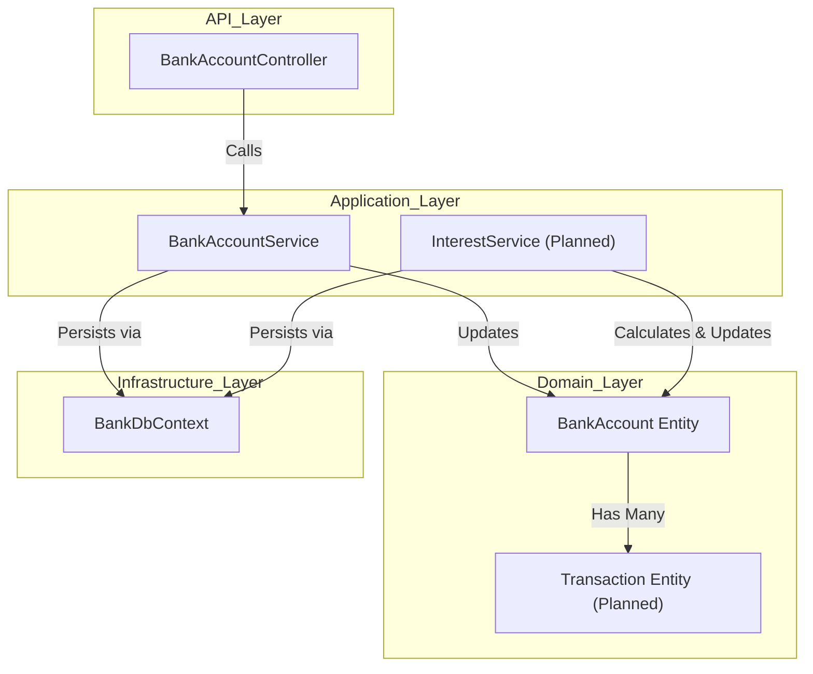
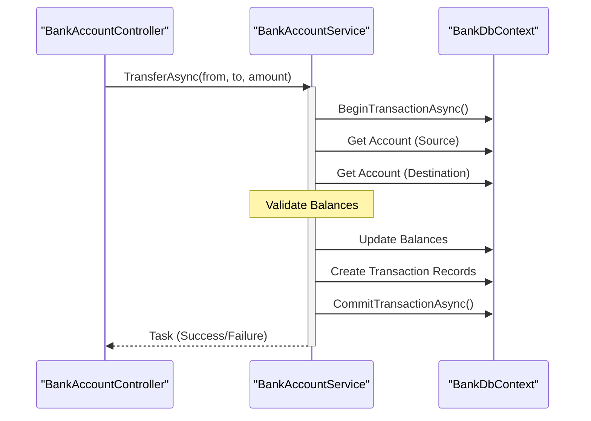

# Planned Features & Roadmap

# Planned Features & Roadmap

Relevant source files

The following files were used as context for generating this wiki page:

- [README.md](README.md)
- [src/Application/Services/BankAccountService.cs](src/Application/Services/BankAccountService.cs)
- [src/Domain/Interfaces/IBankAccountService.cs](src/Domain/Interfaces/IBankAccountService.cs)

This page outlines the technical requirements and implementation strategy for the banking operations and security measures specified in the project requirements that are currently in a scaffolded or unimplemented state.

## Core Banking Operations

The current implementation of `BankAccountService` [src/Application/Services/BankAccountService.cs:7-20]() and `IBankAccountService` [src/Domain/Interfaces/IBankAccountService.cs:5-8]() contains placeholders. The following operations must be integrated into these layers.

### Deposit and Withdrawal
These operations involve modifying the `AccountBalance` of a `BankAccount` entity.
*   **Implementation**: New methods `DepositAsync(string accountNumber, decimal amount)` and `WithdrawAsync(string accountNumber, decimal amount)` will be added to `IBankAccountService`.
*   **Logic**: The service must fetch the account via `BankDbContext`, validate the amount (e.g., non-negative, sufficient funds for withdrawals), update the balance, and persist changes.

### Internal Transfers
Transfers require atomic operations to move funds between two accounts.
*   **Data Flow**: The `BankAccountService` will initiate a database transaction via `_dbContext.Database.BeginTransactionAsync()` to ensure that the debit from the source account and credit to the destination account both succeed or fail together.

### Transaction History
To meet the acceptance criteria for a "lista de transacciones" [README.md:7-7](), a new `Transaction` entity is required.
*   **Entity Properties**: `Id`, `AccountId`, `Amount`, `TransactionType` (Deposit, Withdrawal, Transfer, Interest), and `Timestamp`.
*   **Relationship**: A one-to-many relationship between `BankAccount` and `Transaction` must be configured in `BankDbContext`.

**Sources:** [README.md:6-10](), [src/Application/Services/BankAccountService.cs:7-20](), [src/Domain/Interfaces/IBankAccountService.cs:5-8]()

## Interest Calculation Engine

As per the "Créditos Extra" section [README.md:13-14](), a daily interest calculation mechanism is required.

### Data Model Requirements
The `BankAccount` model must be expanded to include:
*   `InterestRate`: The percentage used for calculation.
*   `LastInterestCalculationDate`: To prevent double-charging/crediting within the same period.

### Implementation Strategy
A background service (implementing `IHostedService` or using a library like Hangfire) will be created to execute the calculation logic.

| Component | Responsibility |
| :--- | :--- |
| `InterestCalculationJob` | A background task that triggers every 24 hours. |
| `InterestService` | Logic to calculate `Balance * (Rate / 365)` and update the `BankAccount`. |
| `BankDbContext` | Updates the balance and logs a `Transaction` of type `Interest`. |

**Sources:** [README.md:13-14](), [README.md:19-20]()

## System Evolution Diagram

The following diagram illustrates how the current code entities will interact with the planned components.

"Banking Logic Integration Map"

**Sources:** [src/Application/Services/BankAccountService.cs:7-14](), [src/Domain/Interfaces/IBankAccountService.cs:5-8](), [README.md:14-14]()

## Security Requirements

The project roadmap includes hardening the API against common vulnerabilities as specified in the evaluation criteria [README.md:34-34]().

### SQL Injection Prevention
*   **Current State**: The project uses Entity Framework Core [src/Application/Services/BankAccountService.cs:9-14]().
*   **Strategy**: Ensure all queries continue to use LINQ or parameterized raw SQL. Avoid string concatenation when building queries within the `Infrastructure` layer.

### Cross-Site Scripting (XSS) Prevention
*   **Strategy**: Implement input validation and sanitization on all DTOs (e.g., `BankAccountDto`). Although the current API returns JSON, which reduces XSS risk in modern browsers, any future UI components or HTML-producing endpoints must use standard encoding libraries.

### Data Flow for Planned Operations

"Planned Operation Flow: Transfer"

**Sources:** [README.md:10-10](), [src/Application/Services/BankAccountService.cs:16-19](), [src/Domain/Interfaces/IBankAccountService.cs:7-7]()

## Roadmap Summary

1.  **Phase 1: Persistence Expansion**: Add `Transaction` entity and update `BankAccount` with interest-related fields [README.md:19-19]().
2.  **Phase 2: Core Logic**: Implement `Deposit`, `Withdraw`, and `Transfer` in `BankAccountService` [README.md:8-10]().
3.  **Phase 3: Interest Engine**: Develop the background job for daily interest calculation [README.md:14-14]().
4.  **Phase 4: Security & Validation**: Add FluentValidation for API inputs and ensure global exception handling to prevent sensitive data leaks [README.md:34-34]().

**Sources:** [README.md:1-35]()

---